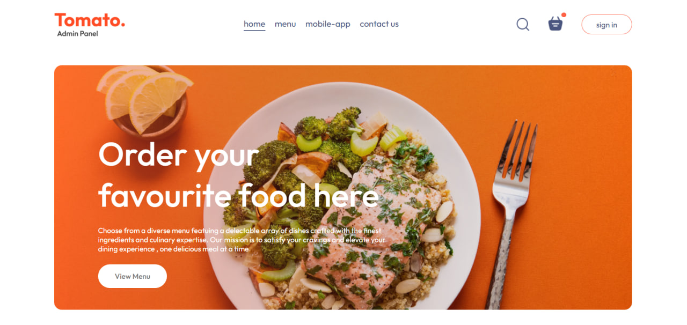
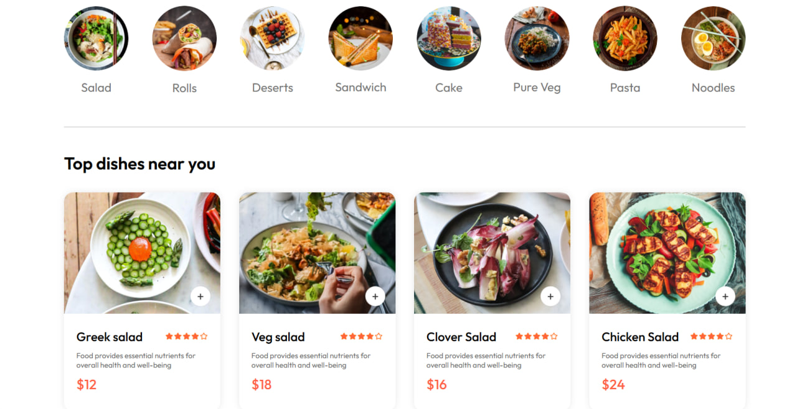
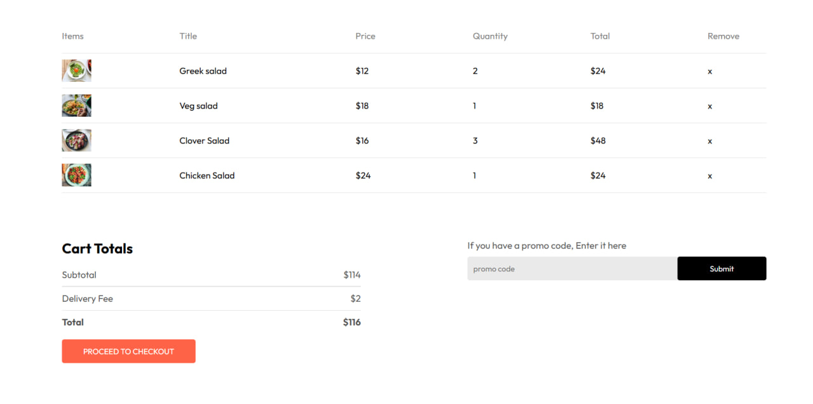

# Food Del

A food ordering web app covering the full customer journey, from browsing the menu to checkout and order tracking.

Live demo: https://restaurant-app-adnan.netlify.app

## Screenshots

## Features

- Browse the menu and filter meals by category
- Cart with automatic quantity and total calculation
- Login, checkout, and order-tracking screens
- Responsive design for mobile and desktop

## Tech Stack

- [React](https://react.dev/) with Hooks for state management
- Deployed on [Netlify](https://www.netlify.com/)

## Getting Started

git clone https://github.com/Adnan-AlTellawy/food-del.git
cd food-del
npm install
npm run dev
Then open the local address shown in your terminal.

## Notes and Future Improvements

This project currently uses static menu data and front-end only login, checkout, and tracking screens. Planned next steps:

- Connect to a backend API for real orders and authentication
- Persist the cart between sessions

## Author

Adnan Jahed Al-Tellawy — Front-End Developer
[GitHub](https://github.com/Adnan-AlTellawy) · [LinkedIn](https://www.linkedin.com/in/adnan-altellawy-497500448) · [Portfolio](https://adnan-altellawy.netlify.app) · adnanaltellawy@gmail.com